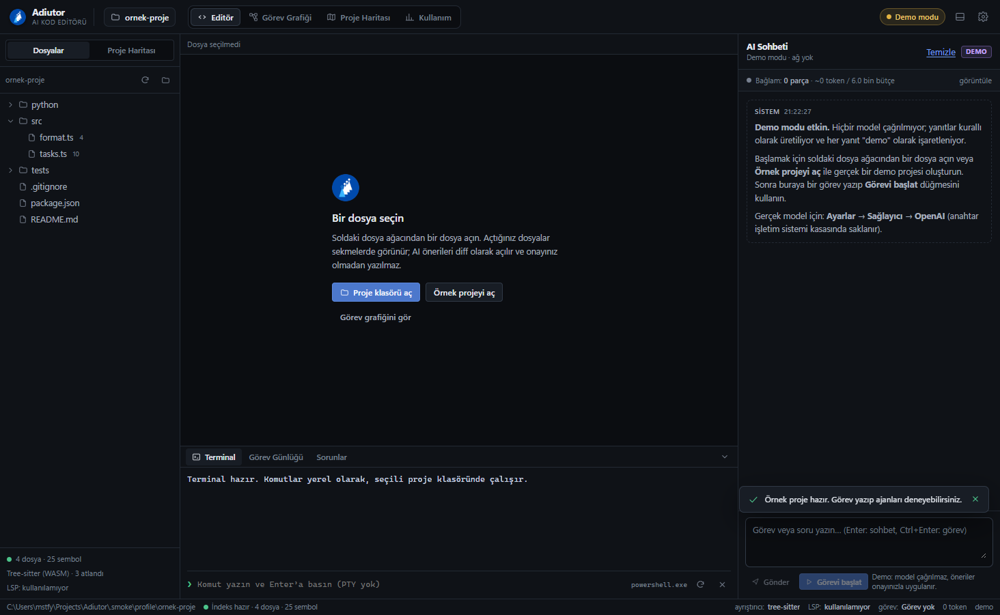
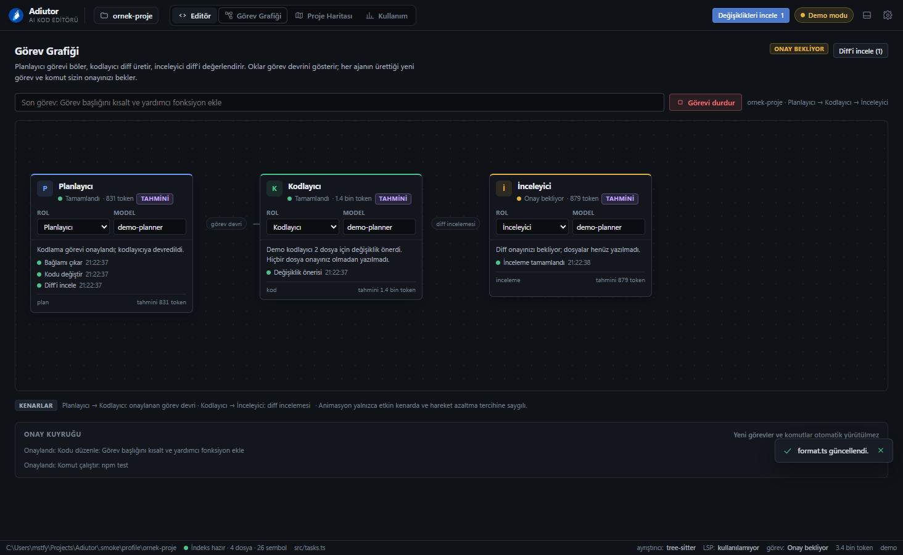
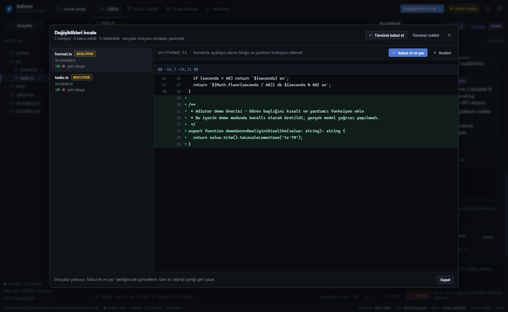
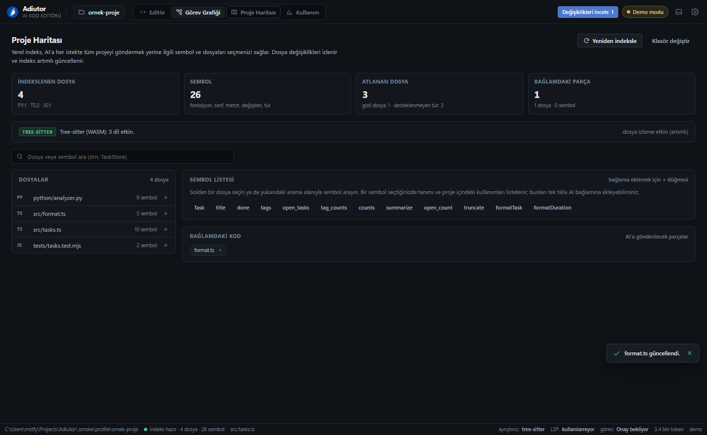
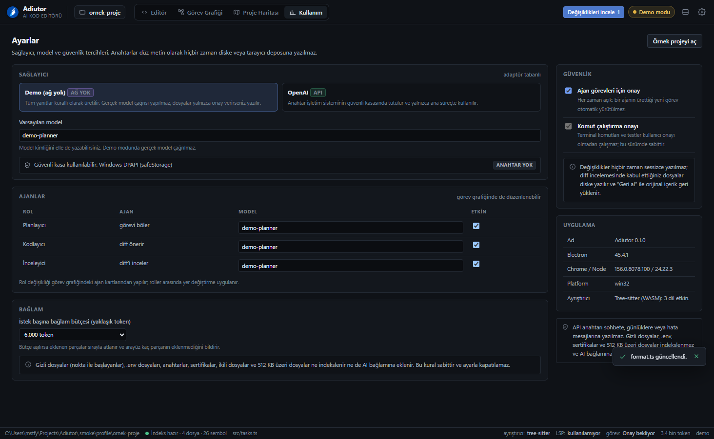
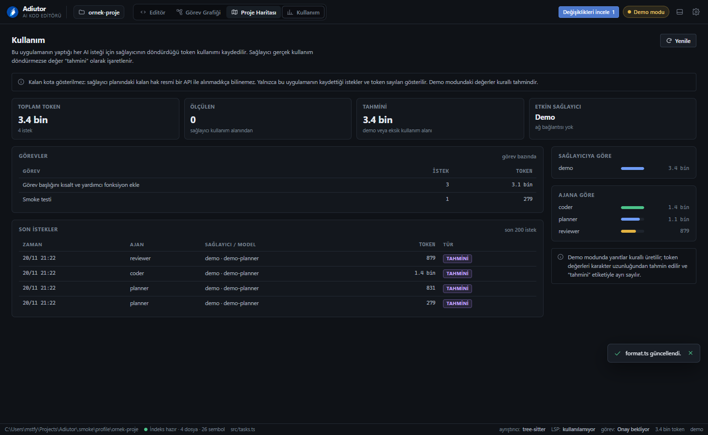
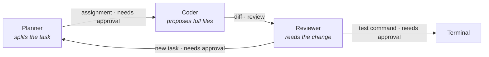

<div align="center">
  <picture>
    <source media="(prefers-color-scheme: dark)" srcset="docs/logo-dark.png">
    
  </picture>
</div>

<p align="center"><b>A local-first code editor where AI agents plan, write and review — and never touch your files without permission.</b></p>

<p align="center">
  <a href="LICENSE"></a>
  
  
  
  
  
</p>

<p align="center">
  <a href="#quick-start">Quick start</a> ·
  <a href="#what-it-does">Features</a> ·
  <a href="#how-it-works">How it works</a> ·
  <a href="#security-model">Security</a> ·
  <a href="#türkçe">Türkçe</a>
</p>

---

**Adiutor** (Latin for *helper*) is a desktop IDE built around a simple bet: an AI that edits code should behave like a careful teammate, not an autocomplete with root access.

Instead of one endless chat, work is split between three agents — a **planner**, a **coder** and a **reviewer**. Each hand-off is visible on a task graph, every proposed file change opens as a real diff, and every command waits for a click. Nothing is written, executed or sent anywhere behind your back.

It runs entirely on your machine. The only network traffic is the one you explicitly configure — an OpenAI key you enter yourself. Without a key, a clearly labelled **demo mode** lets you try the whole workflow offline.

## Why it feels different

| | |
|---|---|
| **Agents, not autocomplete** | Planner splits the task, coder proposes complete file contents, reviewer reads the diff and suggests a test. You see who did what, when, and for how many tokens. |
| **Approval is the default** | File writes only happen after you accept a diff. Commands only run after you approve them. Follow-up tasks an agent invents wait in a queue. |
| **Context you can read** | Before anything is sent to a model, you can open the context drawer and see every snippet, file path and token it costs. |
| **A map, not a guess** | Tree-sitter parses your project into symbols, imports and references, then feeds the agents precise code instead of whole files. |
| **Honest about money** | Token usage is recorded from what the provider actually returns; anything estimated is labelled *estimated*. No invented quota numbers. |

## What it does

<table>
<tr><td width="50%" valign="top">

**Editor**
- Project folder with a file tree and per‑file symbol counts
- Tabbed Monaco editor (TypeScript, JavaScript, Python, JSON, CSS, HTML, Markdown)
- Dirty-state tracking, save, reveal in file manager
- Bottom panel: terminal, task log, diagnostics

</td><td width="50%" valign="top">

**Agents**
- Planner → coder → reviewer graph with labelled hand-offs
- Editable name, role and model per agent
- Per-agent steps, status and approximate token use
- Start / stop a task, follow its live log

</td></tr>
<tr><td valign="top">

**Review**
- Every change shown as a line diff of the full file
- Accept, reject, undo, accept-all / reject-all
- Nothing written until you say so
- Commands and tests gated by an approval card

</td><td valign="top">

**Project map**
- Local Tree-sitter index (WASM, no native build)
- Functions, classes, types, variables, imports
- Definition → usage relations
- Add a symbol or file to the AI context with one click
- Incremental updates from the file watcher

</td></tr>
<tr><td valign="top">

**Chat**
- Project-aware conversation beside the editor
- Visible context chips and a token budget
- Persisted history with a one-click clear
- Demo and live providers always labelled

</td><td valign="top">

**Usage**
- SQLite log of every request, model and token count
- Summary by provider, agent and task
- Estimated vs measured tokens kept apart
- No fake "remaining quota" gauges

</td></tr>
</table>

## Screenshots

<table>
<tr>
<td width="50%"><br><sub><b>Editor</b> — tree, tabs, Monaco, terminal, chat</sub></td>
<td width="50%"><br><sub><b>Task graph</b> — planner, coder, reviewer</sub></td>
</tr>
<tr>
<td><br><sub><b>Review</b> — accept or reject every change</sub></td>
<td><br><sub><b>Project map</b> — symbols, references, context</sub></td>
</tr>
</table>

<p align="center">


</p>

## Quick start

Requirements: **Node.js 22.18+** (or 24) and npm. The sample project's test script runs a TypeScript file directly, which is why 22.18+ is the floor.

```bash
git clone https://github.com/fraisensenpai/Adiutor.git
cd Adiutor
npm install
npm run dev
```

Windows, macOS and Linux are all supported. If npm blocks install scripts, the Electron binary may be missing on first launch — run `node node_modules/electron/install.js` once.

### Your first task (no API key needed)

1. Click **Örnek projeyi aç** (*Open sample project*). A small TypeScript + Python project is generated in your app data folder.
2. Open the task graph, type e.g. `Görev başlığını kısalt ve yardımcı fonksiyon ekle`, press **Görevi başlat**.
3. Approve the planner's hand-off, approve the reviewer's `npm test` command, inspect the diff and accept it.

Demo mode replies are deterministic and offline, and every message carries a `DEMO` badge.

### Use a real model

1. Open **Settings → Provider → OpenAI**.
2. Paste an API key. It is encrypted with the OS keychain (DPAPI, Keychain, libsecret) and never written to the database, logs or chat.
3. Pick a model per agent if you like, then run a task again.

> Adiutor talks to `https://api.openai.com/v1` directly from the main process. No proxy, no account, no telemetry.

## How it works



- **Renderer** (React + zustand) owns the UI and the task runner; it never touches Node APIs directly.
- **Main process** (Electron) owns the filesystem, the index, SQLite, the OS keychain, the terminal and the provider calls, exposed through a typed `contextBridge` API.
- **Indexer** parses files with `web-tree-sitter` (TypeScript, TSX, JS, JSX, Python) and falls back to a regex extractor, saying so in the UI, when a grammar cannot load.
- **Providers** are a small adapter registry: `demo` (offline) and `openai` (chat completions with a JSON contract). A failed contract is reported as an error, never silently retried with made-up data.

```
electron/        main process: window, IPC, workspace, indexer, db, secrets, terminal, lsp
src/core/        task runner, prompts, approval gate, cancellation
src/components/  editor, chat, graph, map, usage, settings, diff
src/shared/      types, IPC contract, token helpers, diff
scripts/         dev launcher, main build, smoke run
```

## Security model

Adiutor is built for code you would not paste into a website.

- **Keys live in the OS keychain.** Stored through Electron `safeStorage`, encrypted per user, never returned to the renderer after saving.
- **No silent writes.** The AI can only *propose* changes. A diff must be accepted; "undo" restores the original content.
- **No silent commands.** Tests and shell commands run only after an approval card is accepted.
- **Workspace jail.** Paths coming from a model are resolved against the open project; traversal, absolute paths and symlink escapes are rejected.
- **Sensitive files stay out.** Dotfiles, `.env*`, keys, certificates, binaries and files over 512 KB are neither indexed nor sent to a model. This cannot be disabled.
- **No telemetry, no cloud account, no OAuth theatre.** The app makes no background requests.

## Scripts

| Command | What it does |
|---|---|
| `npm run dev` | Vite dev server + Electron window with hot reload |
| `npm start` | Builds both bundles and launches the app |
| `npm run build` | Production renderer (`dist/`) and main process (`dist-electron/`) |
| `npm run typecheck` | TypeScript for renderer and main, no emit |
| `npm run smoke` | End-to-end check in an isolated profile with a hidden window; writes screenshots to `.smoke/` |

## Known limitations

- **No installer yet.** Run from source; packaging (`.exe`, `.dmg`, `.AppImage`) is not included.
- **LSP is optional.** If `typescript-language-server` is on `PATH`, diagnostics appear in the Problems panel; otherwise the panel says so. Nothing is installed automatically.
- **No PTY.** The terminal runs commands and captures output; full-screen programs such as `vim` or `top` will not work.
- **Index is per session.** It is rebuilt when a project opens; changes are applied incrementally while the app runs.
- **One window, one project.**
- **Test discovery is simple.** Only `package.json` scripts are suggested as commands.
- **No git integration.** Commits, staging and blame are not part of this version.

## License

[MIT](LICENSE) © 2026 fraisensenpai

---

<div align="center">
  <h1>Türkçe</h1>
  <p><b>Yapay zekâ ajanlarının planladığı, yazdığı ve incelediği; ama iznin olmadan hiçbir dosyaya dokunmadığı, tamamen yerel çalışan bir kod editörü.</b></p>
</div>

Adiutor (Latince *yardımcı*), tek bir fikrin etrafında kuruldu: kod yazan yapay zekâ, kök erişimi olan bir otomatik tamamlamadan çok, dikkatli bir takım arkadaşı gibi davranmalı.

Sonsuz bir sohbet yerine iş üç ajana bölünür: **planlayıcı**, **kodlayıcı** ve **inceleyici**. Her görev devri görev grafiğinde görünür, her dosya değişikliği gerçek bir diff olarak açılır ve her komut senin onayını bekler. Hiçbir şey arka planda yazılmaz, çalıştırılmaz veya bir yere gönderilmez.

Uygulama tamamen kendi bilgisayarında çalışır. Tek ağ trafiği, kendi girdiğin OpenAI anahtarıyladır. Anahtar yoksa açıkça etiketlenmiş **demo modu** ile tüm akışı çevrimdışı deneyebilirsin.

## Neler yapıyor?

- **Editör:** proje klasörü, dosya ağacı ve dosya başına sembol sayısı, sekmeli Monaco, kaydetme, dosyayı sistemde gösterme; alt panelde terminal, görev günlüğü ve tanılamalar.
- **Ajanlar:** planlayıcı → kodlayıcı → inceleyici grafiği; her kartta ad (düzenlenebilir), rol (değiştirilebilir), model, durum, adımlar ve yaklaşık token; görevi başlat/durdur.
- **İnceleme:** her değişiklik dosyanın tamamının satır diff’i olarak gösterilir; kabul, red, geri al, tümünü kabul/red. Onay olmadan tek bayt yazılmaz. Komut ve testler onay kartıyla çalışır.
- **Proje haritası:** Tree-sitter (WASM) ile fonksiyon, sınıf, tür, değişken ve import çıkarımı; tanım–kullanım ilişkileri; tek tıkla AI bağlamına ekleme; dosya izleyiciyle artımlı güncelleme. Gramer yüklenemezse bunu açıkça söyleyip regex yedeğine düşer.
- **Sohbet:** proje özeti ve seçtiğin bağlamla çalışan sağ panel; göndermeden önce **bağlamı görüntüle** (parça, dosya yolu, token); kalıcı geçmiş ve tek tıkla temizleme; demo/gerçek sağlayıcı her zaman etiketli.
- **Kullanım:** her istek SQLite’a yazılır; sağlayıcı, ajan ve görev bazında özet; “ölçülen” ve “tahmini” ayrı gösterilir; uydurma kota göstergesi yoktur.
- **Güvenlik:** anahtarlar işletim sistemi kasasında (DPAPI / Keychain / libsecret) şifreli tutulur, arayüze geri verilmez; gizli dosyalar, `.env`, anahtarlar, sertifikalar, ikili ve 512 KB üzeri dosyalar indekslenmez ve modele gönderilmez; modelden gelen yollar proje köküne hapsedilir (`..`, mutlak yol ve dışarı çıkma reddedilir).

## Hızlı başlangıç

Gereksinim: **Node.js 22.18+** (veya 24) ve npm.

```bash
git clone https://github.com/fraisensenpai/Adiutor.git
cd Adiutor
npm install
npm run dev
```

- **Örnek projeyi aç** ile küçük bir TypeScript + Python projesi oluşturulur.
- Görev grafiğinde bir görev yaz (örn. `Görev başlığını kısalt ve yardımcı fonksiyon ekle`), **Görevi başlat**.
- Planlayıcının devrini onayla, inceleyicinin `npm test` komutunu onayla, diff’i incele ve kabul et.

Gerçek model için **Ayarlar → Sağlayıcı → OpenAI** bölümüne anahtarını gir; model seçimini ajan bazında değiştirebilirsin. Anahtar yalnızca işletim sistemi kasasında saklanır; veritabanına, loglara veya sohbete yazılmaz.

## Komutlar

| Komut | Açıklama |
|---|---|
| `npm run dev` | Vite + Electron, sıcak yeniden yükleme |
| `npm start` | Derleyip uygulamayı açar |
| `npm run build` | Üretim derlemesi (`dist/`, `dist-electron/`) |
| `npm run typecheck` | Arayüz ve ana süreç için TypeScript denetimi |
| `npm run smoke` | Ayrı profilde, görünmez pencerede uçtan uca test; ekran görüntüleri `.smoke/` |

## Bilinen sınırlamalar

- **Paketleme yok:** uygulama kaynak ağacından çalışır; `.exe` / `.dmg` üretimi bu sürümde yok.
- **LSP isteğe bağlı:** `typescript-language-server` kuruluysa tanılamalar gelir, değilse panel bunu söyler; otomatik kurulum yapılmaz.
- **PTY yok:** terminal komut çalıştırıp çıktıyı yakalar; `vim`, `top` gibi tam ekran programlar çalışmaz.
- **İndeks oturum içidir:** proje açıldığında taranır, çalışma sırasında artımlı güncellenir.
- **Tek pencere, tek proje.**
- **Test komutu yalnızca `package.json` betiklerinden önerilir.**
- **Git entegrasyonu yok:** commit, stage, blame bu sürümde bulunmaz.

## Lisans

[MIT](LICENSE) © 2026 fraisensenpai
